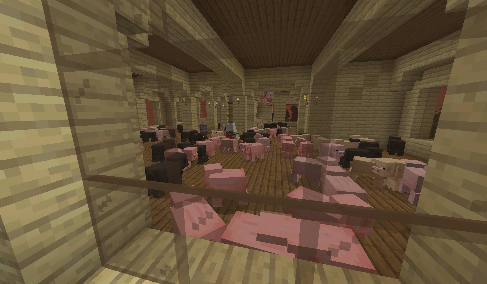
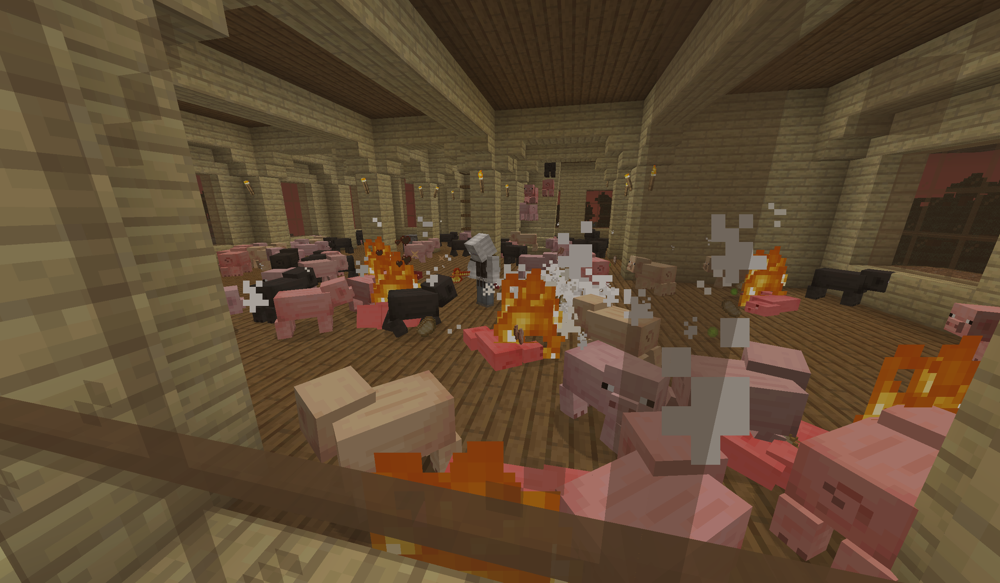
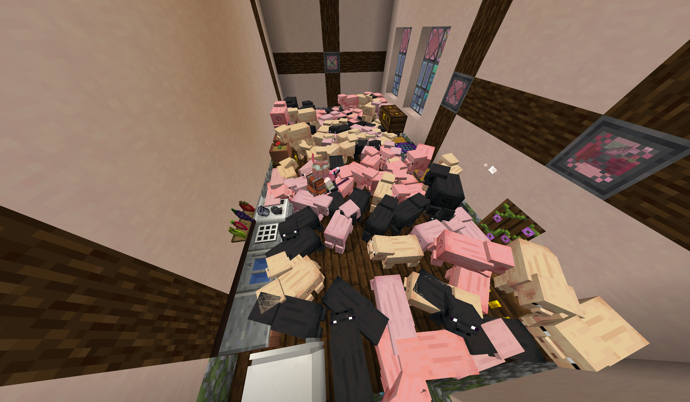
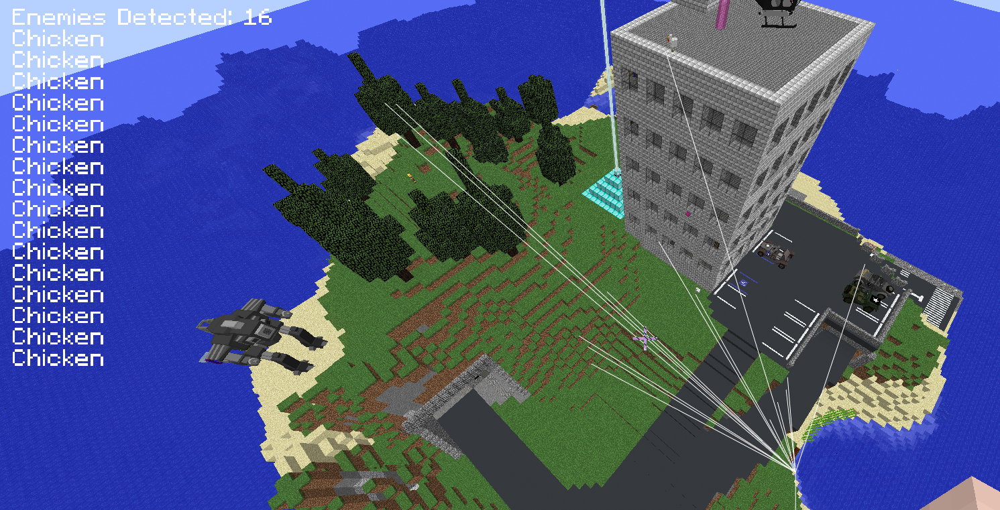

# ComputerCraft Projects

> **Heads up:** this repo is several years' worth of ComputerCraft projects crammed into one place. Some are polished, some are experiments, and all of them were written for fun while playing Minecraft with friends. Each project lives in its own folder and runs on its own in-game computer.

## Why ComputerCraft?

ComputerCraft is my favorite Minecraft mod, and honestly one of my favorite things to program for, period. It drops real, programmable computers into the game: you write Lua, wire up monitors, modems and redstone, and suddenly a block game becomes a sandbox for building actual systems. What hooks me is how far it reaches. A computer sitting in a Minecraft base can talk to Discord, read and write a Google Sheet, run a GUI on a wall of monitors, or watch for intruders, all built out of the same blocks you'd use to make a house.

It's also been a genuinely great teacher: event loops, multitasking with coroutines, networking between machines, talking to real web APIs, and designing for hardware that's a little bit janky. Over the years I've built a lot of little systems for the servers I play on with friends, and this repo is my attempt to finally collect them in one place.

More projects will land here over time as I dig them up.

---

## Requirements

| Mod                                                                                       | Used for                                                                  |
| ----------------------------------------------------------------------------------------- | ------------------------------------------------------------------------- |
| [CC: Tweaked](https://tweaked.cc/)                                                        | Everything (the computers themselves)                                     |
| [Advanced Peripherals](https://www.curseforge.com/minecraft/mc-mods/advanced-peripherals) | Chat Box, Player Detector, RS Bridge, Block Reader, Redstone Integrator   |
| Refined Storage                                                                           | Shop item buyback, Botania wool engine                                    |
| Botania                                                                                   | Botania wool engine                                                       |
| [Plethora](https://plethora.madefor.cc/)                                                  | A couple of old projects, unfortunately it hasn't been updated in a while |


The shop, chat logger and dimension tracker need the CC: Tweaked **HTTP API enabled** in the server config.

## Repo layout

```
lib/                 shared modules (copy onto any computer that needs them)
shop/                ComputerCraft Shop: two computers, Google Sheets backend
dimension-tracker/   intruder alarm for a private dimension
botania/             automated Spectrolus wool feeder
misc/                small one-file utilities
unincluded-projects/ screenshots/videos of older projects without code
```

Programs load their config and data files from the **root of the in-game computer**, so copy a project's files (plus anything it needs from `lib/`) onto the computer together.

---

## Projects

### ComputerCraft Shop (`shop/`)

A player-run shop that buys items from players at prices that react to supply, with all balances stored in a **Google Sheet**. It runs on two computers that coordinate over a modem.

- **`storeUI.lua`** is the shop front. It detects who has walked into the shop (by bounding box and dimension), shows their name and balance on a monitor, logs visits to Discord, and tells the second computer who to credit. It installs Basalt itself on first run.
- **`itemGUI.lua`** is the bounty board and buyback counter. It shows a paged list of items the shop is buying. When a player drops items in the barrel and hits the deposit button, it prices everything, pulls it into Refined Storage, and credits the shopper's balance in the sheet. Prices scale with stock: `price × medianPoint ÷ amountInStorage`, clamped between a min and max, and the shop stops buying an item once storage passes its max amount.
- **`sheetsAPI.lua`** is a small Google Sheets v4 REST client: reading ranges, appending rows, and updating cells for the `ItemBounties` and `PlayerBalances` tabs.
- **`oauth.lua`** handles Google OAuth 2.0 from inside Minecraft. The Chat Box sends you a clickable login link in game chat, you paste the code back into the computer, and from then on it refreshes its own tokens.
- `playerChecker.lua` is a background tab that polls the Player Detector, and `storeInfoManager.lua` persists local shop state. `shopperUI.lua` is a work-in-progress redesign of the shop front screen.

### Dimension Tracker (`dimension-tracker/`)

**`dimensionTracker.lua`** is an intruder alarm for a private dimension; mine guarded my Tardis. When anyone not on the allowlist enters or leaves, everyone on the notify list gets an in-game toast notification and a colored Discord message goes out. It's managed entirely through hidden chat commands (`$setDim`, `$addDim <player>`, `$addNotify <player>`, and so on), so there's no need to walk back to the computer.

### Botania Wool Engine (`botania/`)

**`botaniaWoolEngine.lua`** keeps a Spectrolus fed. A Spectrolus only makes mana from wool in a strict color order, so the script reads the flower's mana and which color it wants next with a Block Reader, then has the RS Bridge drop exactly that wool into an open crate, one at a time, until the flower is full. `woolOrder.json` holds the color sequence.

### Misc (`misc/`)

- **`chatLogger.lua`** mirrors server chat, joins and leaves into a Discord channel.
- **`treeFarm.lua`** toggles a tree farm on and off with a hidden chat command.
- **`playerDoor.lua`** opens a door only for authorized players standing next to it.

### Shared modules (`lib/`)

- **`discordWebhook.lua`** posts messages to a Discord webhook. The URL is read from `webhookURL.txt` (gitignored; see `webhookURL.example.txt`), and @mentions are disabled so in-game chat can't ping anyone.
- **`helperFunctions.lua`** has string padding, rounding, clamping and table helpers.

---

## Unincluded Projects

Some older projects didn't survive (lost worlds, dead servers, old PCs), but I still want to show them off. These are screenshots and videos of things I built without the code to go with them.

<!--
Template: copy this block for each project. Put images/videos in unincluded-projects/media/.

### Project Name
*Year · Server/Modpack*

Short description of what it did and how it worked.


Video: https://youtu.be/your-video-id
(or drag an .mp4 into the README on GitHub's web editor to embed it inline)
-->
### Mob Teleporter
*2020 · Custom Modpack*

A super fun project which combined a couple of different magic mods to great effect. 


### Island ESP
*2016 · Custom PVP Modpack*

This was a super extensive project. It used several different mods, the base computercraft mod, Plethora for the GUI, along with advanced peripherals for the mod detection system. The idea here was to have a whitelist of entities on the island, and whenever an entity entered the island an alert would be drawn ontop of my HUD and I would have a line drawn directly to them. The included screenshot is the system working with some chickens scattered around the island. Unfortunately, by the time I had the system up and running my friends had lost interest in playing on the server, so I never managed to get a screenshot of it in action. Definitely one of my favorite projects I've ever done, however. 




---

## Libraries

### Basalt

Most of my monitor GUIs are built with **[Basalt](https://github.com/Pyroxenium/Basalt)** by **Pyroxenium**, an MIT-licensed UI framework for CC: Tweaked ([docs](https://basalt.madefor.cc/)). It made building real interfaces (frames, lists, buttons, paging) on in-game monitors far easier than drawing everything by hand. Basalt isn't bundled in this repo; `storeUI.lua` downloads it automatically, or you can install it yourself from the Basalt docs. Thanks to Pyroxenium for building and sharing it.

## Credits & Thanks

**ComputerCraft** was created by **Daniel Ratcliffe ([dan200](https://github.com/dan200/ComputerCraft))** and first released on December 24, 2011. It turned Minecraft into a place where you could learn to program just by wanting to build something cool, and it's had a huge influence on me.

**[CC: Tweaked](https://github.com/cc-tweaked/CC-Tweaked)**, the actively maintained continuation of ComputerCraft that everything here runs on, is led by **Jonathan Coates ([SquidDev](https://github.com/SquidDev))** along with its contributors. Keeping a mod this beloved alive, fast and full of new features across so many Minecraft versions is a massive amount of work.

**[Advanced Peripherals](https://github.com/IntelligenceModding/AdvancedPeripherals)** by **Srendi** and the IntelligenceModding team provides nearly every peripheral these projects rely on (chat box, player detector, RS bridge, block reader).

**Thank you** to dan200 for creating ComputerCraft and to SquidDev for carrying it forward. Years of my favorite projects exist because of your work. ❤️
